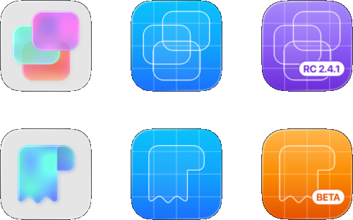

# Blueprint Icons



A small macOS app that puts a friendly interface on top of **[blueprint](https://github.com/MustafaNatur/blueprint)**, the command line tool by **Mustafa Natur** that turns an app icon into a blueprint style version for your debug builds.

Instead of remembering flags in Terminal, you drop in an icon, pick a name and folder, tweak the options, and press **Create Icon**.

## Credit where it is due

**All of the real work of making blueprint icons is done by [blueprint](https://github.com/MustafaNatur/blueprint), created by [Mustafa Natur](https://github.com/MustafaNatur) and released under the MIT license.** This app does not contain or redistribute blueprint. It simply finds the copy you have installed and runs it for you with the options you choose.

This project is an independent front end. It is not affiliated with, endorsed by, or maintained by the author of blueprint. If you like the results, please star and support the original project.

## Please read: this app was vibe coded

This app was **almost entirely written by Claude** (Anthropic's AI model, working through Claude Code), directed by [Stewart Lynch](https://createchsol.com). Stewart described what he wanted, made the design decisions, built and ran the app in Xcode, and reported back what he saw. Claude wrote essentially all of the Swift code, the project structure, this README, and the app icon.

What that means for you:

- **Treat it as a hobby project, not audited software.** It has been tested by hand, not with an automated test suite, and there are no unit tests yet.
- The code was not written line by line by a human. Review it before relying on it, especially if you adapt it for anything important.
- Bugs are likely to turn up. Issues and pull requests are welcome.
- The app runs a command line tool on your Mac, with App Sandbox turned off (see below). Read the code if you want to be sure about what it does. It is small.
- The same applies to the compiled app on the Releases page. It is built from this code, by hand, in Xcode.

## What it does

- Checks that `blueprint` is installed, and if it is not, shows copyable install instructions and re-checks for you.
- Takes a `.icon` file (Icon Composer) or a `.appiconset` folder, by drag and drop or the Open button.
- Asks where to save the result and what to call it. The extension is added for you and is never doubled if you type it.
- Offers every blueprint option:

| In the app | blueprint option |
|---|---|
| Save folder and name (always used) | `-o` / `--output` |
| Custom background colors (top, middle, bottom, with a live gradient preview) | `--color` |
| Line width (default 9) | `--line-width` |
| Add a badge, with your own text | `--badge` |
| Show background grid (on by default) | `--no-grid` when turned off |

- Always passes `--no-open`, so the app shows its own result with **Reveal in Finder** and **Open in Icon Composer** buttons.
- Warns you before overwriting something, and refuses to replace your own source icon.
- Shows the exact Terminal command, so you can copy it and run it yourself.
- Remembers only your last output folder. All style options start at their defaults each time.

## Download

Grab the latest build from the [Releases page](../../releases/latest). Unzip it and drag **Blueprint Icons** into your Applications folder. You still need to install blueprint separately (see below). The app checks for it and shows you how if it is missing.

If macOS refuses to open the app because it was downloaded from the internet, right-click it and choose Open, or go to System Settings > Privacy & Security and choose Open Anyway. If you would rather not run a downloaded binary, build it yourself from source (see Building).

## Requirements

- macOS 26 or later (the app's deployment target)
- Xcode 26 or later, to build the app. Icon Composer, which ships with Xcode 26, is needed to open `.icon` results.
- The `blueprint` command line tool (see below)

## Installing blueprint

If it is missing, the app will show these instructions too.

With Homebrew (recommended):

```
brew install mustafanatur/tap/blueprint
```

Or from source (needs Xcode 26 or later):

```
git clone https://github.com/MustafaNatur/blueprint.git
cd blueprint
make install
```

That installs it to `~/.local/bin`. The app looks there, in `/opt/homebrew/bin` and `/usr/local/bin`, and in your login shell's `PATH`. If it is somewhere else, use **Choose blueprint Manually** on the setup screen.

See the [blueprint README](https://github.com/MustafaNatur/blueprint) for its own documentation.

## Building

You only need this if you want to build the app yourself instead of using a release.

1. Clone this repository.
2. Open `Blueprint Icons.xcodeproj` in Xcode 26 or later.
3. Set your own signing team under Signing & Capabilities.
4. Build and run.

## Using the app

1. Drop a `.icon` file or `.appiconset` folder on the target, or press **Open**.
2. Choose the output folder and type a name (without the extension).
3. Adjust the style options if you want to.
4. Press **Create Icon**, then reveal the result or open it in Icon Composer.

### Keyboard shortcuts

| Action | Shortcut |
|---|---|
| Open a source icon | ⌘O |
| Choose output folder | ⇧⌘O |
| Create icon | ⌘↩ |
| Copy Terminal command | ⇧⌘C |
| Reveal result in Finder | ⇧⌘R |
| Open result in Icon Composer | ⇧⌘I |
| Dismiss result | esc |
| Check for blueprint again | ⌘R |

## Notes on security and privacy

- **App Sandbox is turned off.** The app has to launch the `blueprint` executable from wherever you installed it, which a sandboxed app cannot do. Because of that the app is intended for direct distribution, not the Mac App Store.
- The app makes no network connections and collects nothing. The only things it runs are `blueprint`, plus your login shell once to look up where `blueprint` is installed.
- Links in the About window open in your browser.

## Project layout

```
Blueprint Icons/
  Models/     options, name cleaning, colors, remembered folder
  Services/   running processes, finding blueprint, building arguments, checking output
  Views/      source drop target, output, style options, results, setup, About
AppIcon.icon  the app's own icon, in Icon Composer format
```

## Contributing

Issues and pull requests are welcome. If you use an AI tool to help with a contribution, please say so in the pull request, as was done here.

## License

No license has been chosen yet. Until one is added to this repository, all rights are reserved by default. *(Stewart: add a LICENSE file and update this section before publishing. MIT would match blueprint.)*

blueprint is © Mustafa Natur and licensed under the MIT license. See its repository for details.
